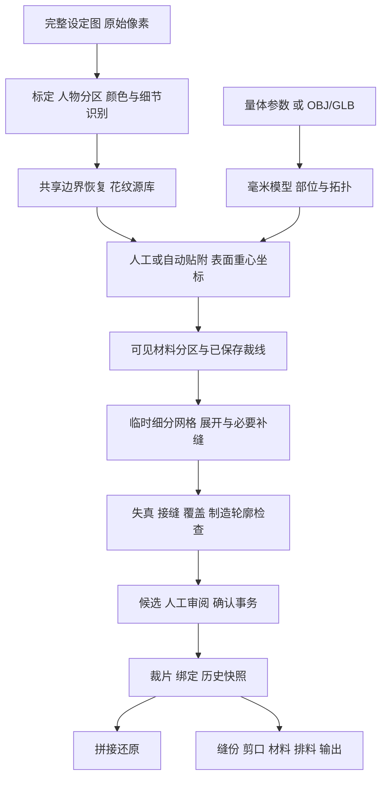

# 算法与几何数据流

核对日期：2026-10-26；依据 0.8.0 当前工作区源码（提交 `0bd71c8`）。本轮只审阅实现，未运行算法测试或以实物验证结果。数值为当前实现约束，不是所有输入的成功率保证。

## 从像素到毫米纸样

| 阶段 | 实现入口 | 数据及失败边界 |
| --- | --- | --- |
| 原图识别 | [automatic-reference.ts](../../apps/desktop/main/automatic-reference.ts)、[illustration.ts](../../packages/reference/illustration.ts)、[sheet-figures.ts](../../packages/reference/sheet-figures.ts) | 保存完整原图，识别源区及人物上下文；不确定语义留给人工 |
| 轮廓恢复 | [shared-contour.ts](../../packages/reference/shared-contour.ts)、[recover-contour.ts](../../packages/reference/recover-contour.ts) | 在原像素尺度拟合共享边界，失败回退；见[专题](reference-contour-recovery.md) |
| 模型生成 | [wearer.ts](../../apps/desktop/main/wearer.ts)、[species-loft.ts](../../apps/desktop/main/species-loft.ts)、[species-assembly.ts](../../apps/desktop/main/species-assembly.ts) | 生成身体／角色部件并组合；不同模式的制作对象不同 |
| 配准贴附 | [automatic-placement.ts](../../apps/desktop/main/automatic-placement.ts)、[anatomical-placement.ts](../../apps/desktop/main/anatomical-placement.ts)、[mapping.ts](../../packages/surface/mapping.ts) | 使用人物、部位、左右、可见面和局部表面；歧义可以跳过 |
| 材料分区 | [design-cuts.ts](../../apps/desktop/main/design-cuts.ts)、[material-tiles.ts](../../packages/surface/material-tiles.ts)、[garment-sections.ts](../../packages/surface/garment-sections.ts) | 处理可见缝制材料，保留原面来源；结构缝限制连接 |
| 展开调度 | [surface.ts](../../apps/desktop/main/surface.ts) 的 `unwrapSurface` | 组织解算、补缝、修复、合并和预算；不能发布半个有效候选 |
| 原生几何 | [surface.rs](../../crates/geometry-core/src/surface.rs)、[arap.rs](../../crates/geometry-core/src/arap.rs)、[allowance.rs](../../crates/geometry-core/src/allowance.rs) | 独立 JSON 工作进程运行求解、校验和偏移 |
| 制造输出 | [manufacturing](../../packages/manufacturing/)、[nesting.ts](../../apps/desktop/main/nesting.ts)、[export.ts](../../apps/desktop/main/export.ts) | 使用实际制造轮廓，重新检查依赖和问题，按毫米输出 |

## 单位和坐标

设定图标定比例为 `s = distanceMm / hypot(b.x-a.x, b.y-a.y)`。像素点连同原点、方向和图像变换映射为毫米；自动按图高估算只提供起点，不是实际量体证据。改变显示缩放不能改变这个比例。

模型、版片和缝份长度使用毫米，面积使用平方毫米。OBJ 导入倍率由用户指定；GLB 按米转换为毫米后再使用附加倍率。PDF 用 `72 / 25.4` 把毫米转为点，SVG 的尺寸和 `viewBox` 共同表达毫米。见 [surface.ts](../../apps/desktop/main/surface.ts)、[export.ts](../../apps/desktop/main/export.ts)。

三维表面点保存原三角面 ID 和重心权重：`P = w0·V0 + w1·V1 + w2·V2`。材料边界可以落在面内，不能只给整个三角面涂一种颜色。临时细分产生的坐标需合成到原面；二维 `trim` 三角形与原面对应共同支持选择定位、拼接和独立复核。

## 模型与贴附

模型路线包括外部网格、程序躯干、物种模板、自定义模板、量体拟合和局部编辑。DTD 表达身体，一体填充模式表达衣身，costume 模式表达角色。`assembleSpecies` 使用 Manifold 组合部件并保留区域。这些实现不包含物理填充压缩，也不能由一张设定图唯一恢复三维。

自动贴附使用人物上下文、部位与角色自身左右侧，在同一部位内统一缩放色块；找不到对应位置时跳过，保留原图色块之间的相对位置。实现见 [anatomical-placement.ts](../../apps/desktop/main/anatomical-placement.ts) 和 [automatic-placement.ts](../../apps/desktop/main/automatic-placement.ts)。曲面贴花使用 [decal-chart.ts](../../packages/surface/decal-chart.ts)。手绘、纹理提取以及对称／延伸推断有各自入口，但并非每个接口都在当前页面可达，详见[功能目录](../guides/feature-catalog.md)。确定性几何补全不能称为已部署的生成式 AI。

整体变换与局部改顶点有不同依赖后果：能够精确携带的几何可同步更新，失效绑定必须继续失效。检查入口见 [marking-fingerprint.ts](../../apps/desktop/main/marking-fingerprint.ts)、[surface.ts](../../apps/desktop/main/surface.ts) 的 `bindingIssues`。

## 展开质量的实际定义

Rust 对每个三角面计算：

- 面积误差 `ea = |A2 / A3 - 1|`。
- 边长误差 `ee = max(|l2 / l3 - 1|)`，比较该面三条边。
- 角度误差 `et = max(|angle2 - angle3| / π)`。
- 综合指标 `d = 0.4·ea + 0.4·ee + 0.2·et`。

`distortionMean` 按三维面积加权，`distortionP95` 按面指标排序，后者不是面积加权分位数。设计分区对每面检查硬上限：面积误差 15%、边长误差 10%、综合指标 15%；P95 超过 5% 仍可能要求审阅。综合指标不是布料拉伸百分比，不能代替毛皮拉伸试验。

新接缝约束路线另要求边界单段相对长度误差 ≤0.05%，每片全部边界绝对长度误差之和 ≤0.25 mm，包含孔洞，正负误差不能抵消。两片都满足这个限制，仍需核对它们是否对应同一条边及剪口顺序。[design-partition.ts](../../packages/surface/design-partition.ts) 的 `designQualityFailure`、`measureBoundaryStrain` 是当前检查入口。

## 缝份、排料与分页

缝份来自轮廓偏移，涉及拐角、凹角、孔洞、窄通道和偏移产生的新环，不能由整体缩放代替。排料使用制造轮廓碰撞和材料方向约束；[contours.ts](../../packages/nesting/contours.ts) 当前把外环当实心区域，不把孔洞作为可嵌套空间，也不保证全局最优利用率。

打印分页用 [print-pages.ts](../../packages/manufacturing/print-pages.ts) 计算可打印区域、搭接和页号，保留 100 mm 校验尺。分页搭接、缝份与排料间距分别设置。PNG 还需核对像素与输出尺寸语义，不能依据查看器显示大小判断比例。

## 计算边界

[limits.ts](../../packages/surface/limits.ts) 限制导入／显示网格顶点和面各 200,000，制造展开面预算 50,000，模型文件和曲面工作线程数据预算各 64 MiB；修复最多 12 轮。持久化契约通常最多 500 片，较大的导入预算不等于相同规模的制造求解能力。

`cutPreviewTimeout` 为 `min(900000, max(60000, points×20, automaticDesignFaces×40))` 毫秒。`points` 仅在启用颜色边界时累计花纹片段节点；`automaticDesignFaces` 仅在自动 design 分区时使用表面面数。因此下限为 60 秒，上限为 15 分钟，旧文档“所有任务固定 60 秒”已不适用。其他曲面线程默认 120 秒，各阶段与原生进程还可能有自己的预算。[surface-runtime.ts](../../apps/desktop/main/surface-runtime.ts)

取消或超时需阻止晚到结果写入；接受候选时再次核对版本、来源、几何和审阅状态。超时上限不是预计完成时间，也不是性能验收结果。

## 仍需验收的目标

现有连续截面、省道尝试、接缝校准和合并能构造候选，但未形成完整服装结构缝优化器。最少片数、自然缝位、材料伸缩、内胆生产和全套试穿需单独验收。下一阶段依据[参考图](reference-image-analysis.md)、[需求](../planning/requirements.md)及[验收矩阵](../planning/acceptance-matrix.md)评估，不能使用旧历史片数或耗时代表当前状态。
